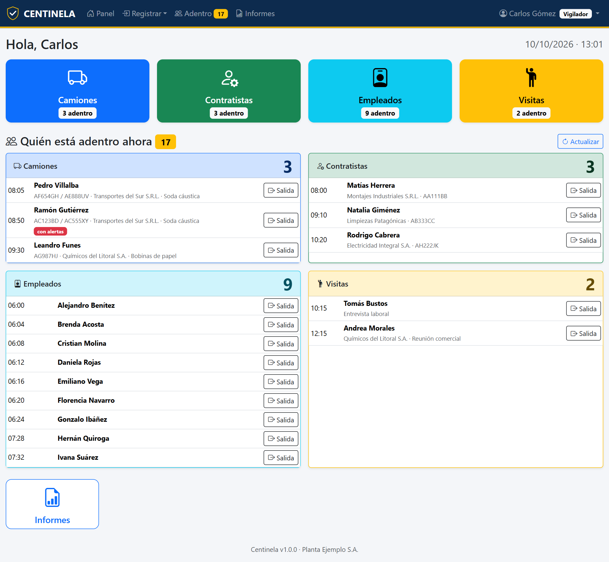
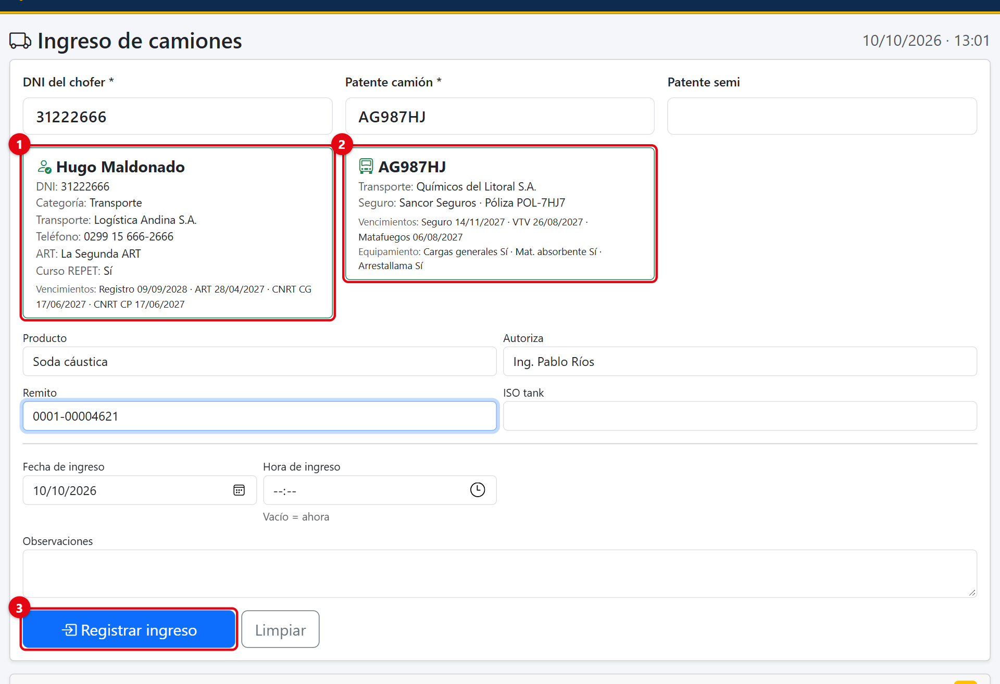
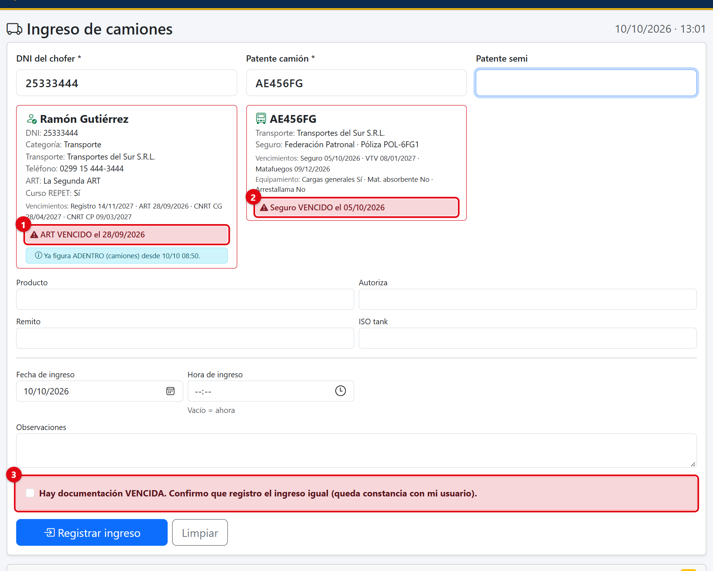
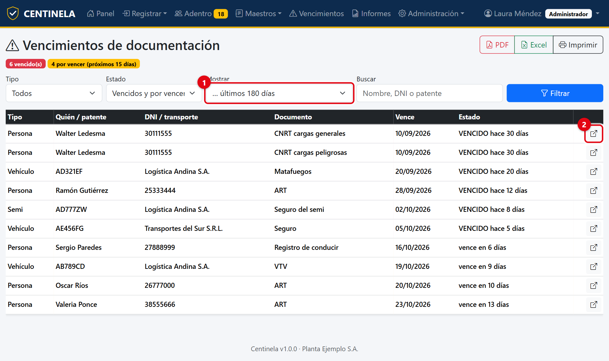
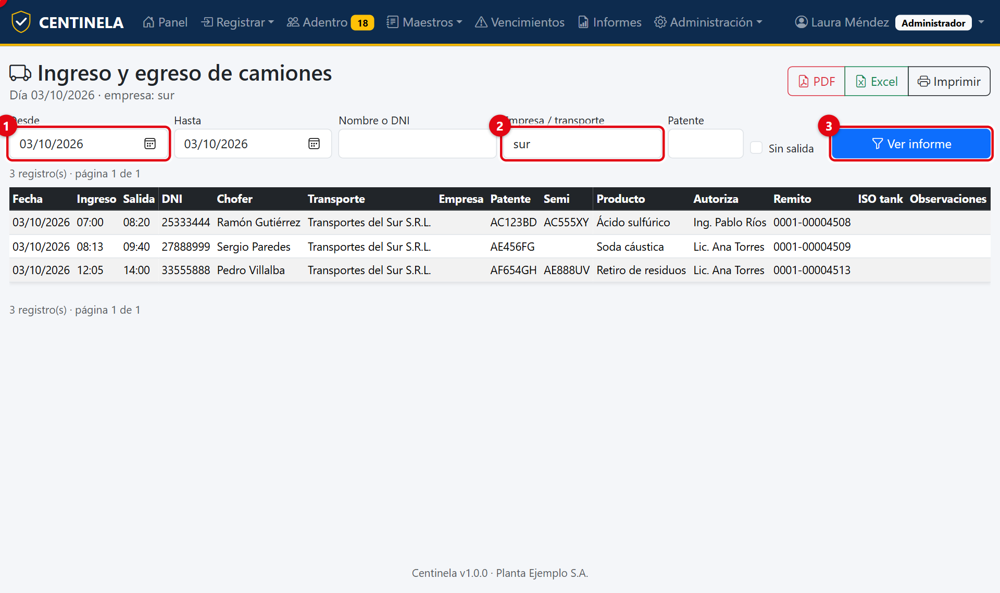
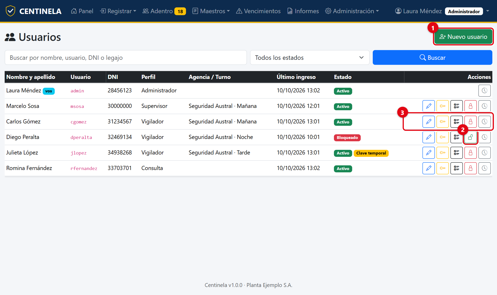
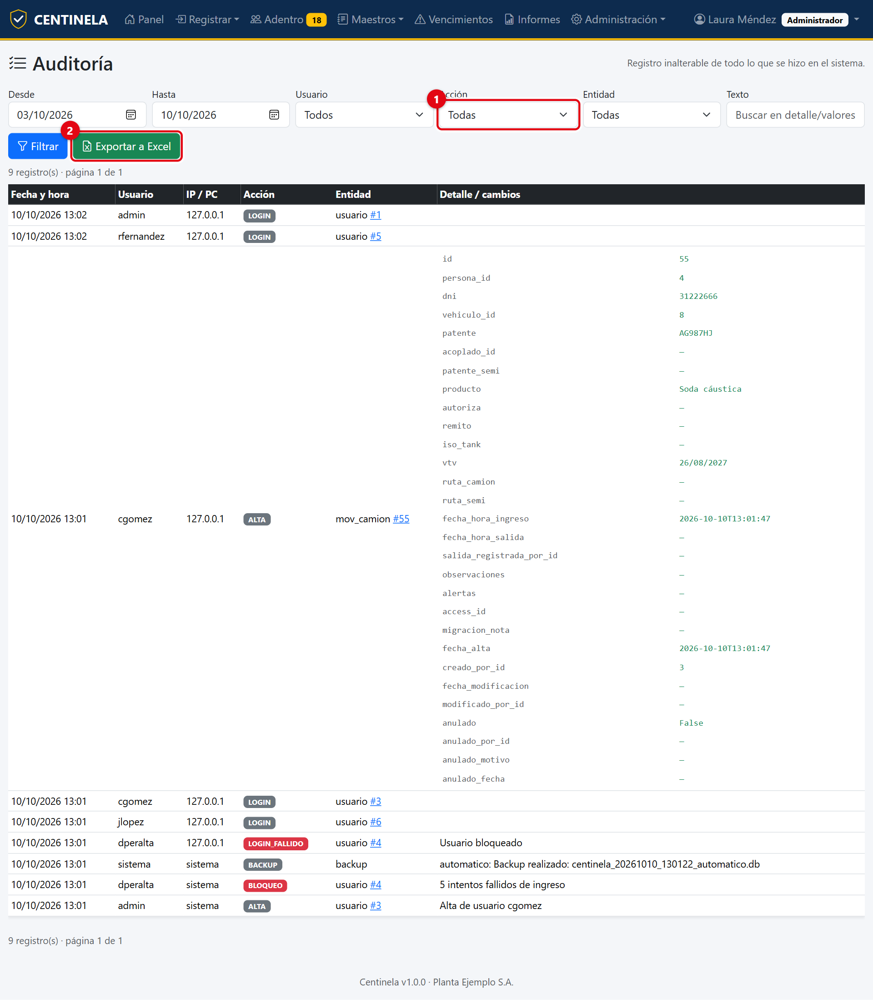
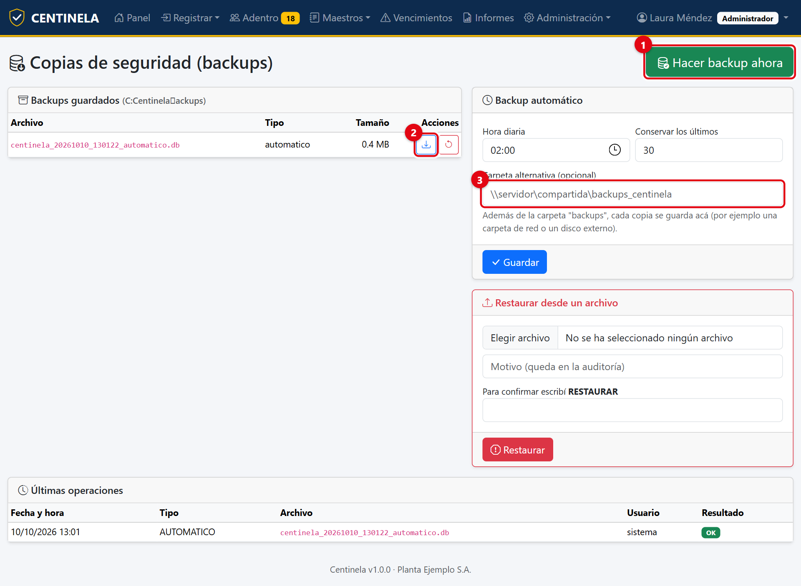

# Centinela · Control de Accesos

**Sistema para la garita de seguridad de plantas industriales y depósitos.** Registra entradas y salidas de camiones, contratistas, empleados y visitas, muestra en todo momento quién está adentro y avisa cuando alguien llega con documentación vencida.

Pensado para reemplazar planillas de Excel y bases de Access. Se instala en una PC de la red de la empresa y se usa desde el navegador. **No necesita internet ni instalar otros programas.**

---

## Probalo gratis 15 días

1. Descargá la **versión de prueba** desde la sección [Releases](../../releases/latest) de esta página.
2. Descomprimí el archivo en cualquier carpeta.
3. Hacé doble clic en **`Centinela.exe`**. Se abre el navegador con el sistema.
4. Entrá con alguno de estos usuarios (la contraseña de todos es `Demo-1234`):

| Usuario | Perfil |
|---|---|
| `admin` | Administrador |
| `msosa` | Supervisor |
| `cgomez` | Vigilador |
| `rfernandez` | Consulta |

La prueba viene con los datos de una empresa de ejemplo y funciona completa durante **15 días**. Después pide una **clave de activación**, que se entrega con la compra de la licencia. Lo que hayas cargado no se pierde.

---

## Qué hace

**En la garita**
- Ingreso de **camiones**: se escribe el DNI del chofer y la patente, y aparecen solos todos los datos.
- Ingreso de **contratistas**, **empleados** y **visitas** (con control de entrega de EPP).
- **Alertas en rojo** si el registro, la ART, el CNRT, el seguro, la VTV o el matafuegos están vencidos, y en amarillo si vencen pronto.
- **Quién está adentro ahora**, con la salida en un clic.
- Alta de choferes y vehículos nuevos en el momento, sin salir de la pantalla.

**Para el responsable**
- **Vencimientos** de toda la documentación, en una sola lista.
- **Informes** por fecha, empresa, persona o patente, en **PDF y Excel**. Informe diario.
- **Usuarios con cuatro perfiles** (Administrador, Supervisor, Vigilador, Consulta) y permisos a medida.
- **Auditoría** inalterable: quién cargó, modificó o anuló cada cosa, y cuándo.
- **Copias de seguridad** automáticas todos los días, y restauración.
- **Avisos por correo**: vencimientos, ingresos con documentación vencida, quién quedó adentro, informe diario.
- Importación desde Excel de las listas de aseguradoras y ART.
- Nada se borra: los registros se **anulan** con motivo.
- Un **ícono junto al reloj de Windows** para iniciar, detener o reiniciar el sistema.

---

## Así se ve

**Ingreso de un camión**

**Alerta de documentación vencida**

**Vencimientos**

**Informes en PDF y Excel**

**Usuarios y permisos**

**Auditoría**

**Copias de seguridad**

---

## Manuales

Están en la carpeta [`manuales`](manuales) y también vienen dentro de la descarga:

- [Manual de Instalación](manuales/Manual%20de%20Instalaci%C3%B3n%20-%20Centinela.pdf)
- [Manual de Usuario](manuales/Manual%20de%20Usuario%20-%20Centinela.pdf)
- [Manual del Administrador](manuales/Manual%20del%20Administrador%20-%20Centinela.pdf)

---

## Licencia y precio

Centinela es **software comercial**. La versión de prueba se puede usar gratis durante 15 días; para seguir usándolo hace falta una licencia. Ver [LICENCIA.md](LICENCIA.md).

| Qué podés comprar | Incluye |
|---|---|
| **Licencia de uso** | Clave de activación para una empresa, sin límite de usuarios ni de tiempo. |
| **Instalación y puesta en marcha** | Instalación en el servidor, carga inicial de datos y capacitación. |
| **Migración de datos** | Pasaje de la información desde Access o Excel. |
| **Código fuente y personalización** | El código completo (no es público: se entrega con la compra) y adaptaciones a medida. |

**Contacto para precios y compra:** Gustavo · contacto@gdtechsoporte.com.ar * +5491138134584

---

## Requisitos

- Una PC o servidor con Windows 10, Windows 11 o Windows Server 2016 o posterior.
- Las PCs de la garita en la misma red, con Chrome o Edge.
